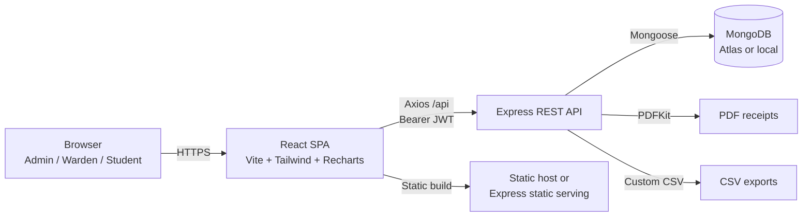
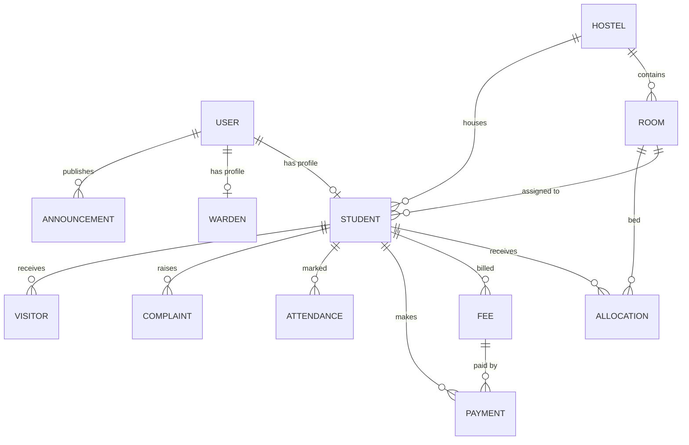

# HostelHub — Project Report & Technical Documentation

**Project:** HostelHub — MERN Hostel Management System  
**Version:** 1.0.0  
**Document type:** Full project report, technical documentation, and viva/interview reference  
**Repository:** `Hostel-Management`  
**Stack:** MongoDB, Express.js, React.js, Node.js (MERN)

---

## Table of contents

1. [Executive summary](#1-executive-summary)
2. [Problem statement](#2-problem-statement)
3. [Objectives](#3-objectives)
4. [Scope](#4-scope)
5. [Key highlights](#5-key-highlights)
6. [Technology stack](#6-technology-stack)
7. [System architecture](#7-system-architecture)
8. [Project structure](#8-project-structure)
9. [Data model and database design](#9-data-model-and-database-design)
10. [Roles and permissions](#10-roles-and-permissions)
11. [Functional modules](#11-functional-modules)
12. [API reference](#12-api-reference)
13. [Security implementation](#13-security-implementation)
14. [Business rules and safeguards](#14-business-rules-and-safeguards)
15. [Analytics and reporting](#15-analytics-and-reporting)
16. [User interface and experience](#16-user-interface-and-experience)
17. [Demo data](#17-demo-data)
18. [Local development setup](#18-local-development-setup)
19. [Build and deployment](#19-build-and-deployment)
20. [Testing and quality assurance](#20-testing-and-quality-assurance)
21. [Performance and scalability](#21-performance-and-scalability)
22. [Limitations](#22-limitations)
23. [Future enhancements](#23-future-enhancements)
24. [Conclusion](#24-conclusion)
25. [Appendix A — Environment variables](#appendix-a--environment-variables)
26. [Appendix B — Demo accounts](#appendix-b--demo-accounts)
27. [Appendix C — Scripts](#appendix-c--scripts)
28. [Appendix D — Glossary](#appendix-d--glossary)

---

## 1. Executive summary

HostelHub is a full-stack hostel management platform built with the MERN stack. It replaces spreadsheets, paper registers, and disconnected messaging with a single role-aware web application for **administrators**, **wardens**, and **students**.

The system manages the complete hostel lifecycle:

- hostel and room inventory;
- student and warden records;
- bed-level room allocations and vacating;
- fee billing, payment collection, and PDF receipts;
- daily attendance;
- complaints and resolution workflow;
- visitor check-in and check-out;
- audience-targeted announcements;
- dashboards, analytics, and CSV exports.

The application has a REST API secured with JWT authentication, bcrypt password hashing, role-based authorization, request validation, rate limiting, Helmet security headers, CORS allow-listing, and MongoDB query sanitisation. The frontend is a responsive React single-page application with a custom design system, live charts, data tables, modals, toasts, and confirmation dialogs.

The project is production-style: it includes a realistic demo data seeder, an end-to-end API smoke test, a production build path, a Docker setup, and this documentation.

---

## 2. Problem statement

Hostel administration in many colleges is still handled through:

- paper registers for attendance, visitors, and complaints;
- spreadsheets for room allocation and fee dues;
- WhatsApp groups for notices;
- manual receipt writing;
- separate files for student and warden records.

This creates several problems:

| Problem | Impact |
| --- | --- |
| Duplicate or conflicting room allocations | Disputes, overbooking, manual reconciliation |
| No single source of truth | Inconsistent student, room, and fee data |
| Manual fee tracking | Missed dues, incorrect balances, slow receipts |
| Paper attendance | Lost records, no trend analysis |
| Untracked complaints | Delayed resolution and no accountability |
| Unrecorded visitors | Security and safety risks |
| Scattered announcements | Students miss important notices |
| No analytics | Management cannot see occupancy, revenue, or attendance trends |

HostelHub addresses these problems with a centralized database, enforced business rules, role-scoped access, and real-time dashboards.

---

## 3. Objectives

The project was built with the following objectives:

1. **Centralize hostel operations** in one web application.
2. **Provide role-specific experiences** for admin, warden, and student users.
3. **Prevent allocation conflicts** through bed-level validation.
4. **Automate occupancy and capacity calculations** when rooms or allocations change.
5. **Digitize fee billing and payment collection**, including downloadable receipts.
6. **Track attendance, complaints, visitors, and announcements** in a structured way.
7. **Expose actionable analytics** through dashboards and reports.
8. **Enforce security at the API layer**, independent of the frontend UI.
9. **Demonstrate a production-style MERN architecture** suitable for academic evaluation and real deployment.
10. **Remain easy to run locally** with seeded demo data and a one-command setup.

---

## 4. Scope

### In scope

- Authentication and role-based access control.
- Hostel, room, student, and warden management.
- Room allocation and vacating.
- Fee creation, bulk generation, and payment recording.
- PDF payment receipts.
- Daily and bulk attendance.
- Complaint lifecycle management.
- Visitor logging.
- Announcements with audience targeting.
- Admin analytics and CSV exports.
- Profile and password management.
- Demo data seeding.
- Local, Docker, Render, and Vercel deployment paths.

### Out of scope

- Real online payment gateway integration (payments are recorded manually).
- Biometric or QR-based attendance.
- File or document uploads (for example, ID card scans).
- Email, SMS, or push notifications.
- Parent/guardian portal.
- Multi-campus or multi-tenant organisation hierarchy.
- Native mobile applications.
- Real-time chat or messaging.
- Accounting, payroll, or inventory modules.

---

## 5. Key highlights

- **Three role-based dashboards:** admin, warden, and student.
- **Twelve MongoDB models** covering the full hostel domain.
- **Eleven operational modules** plus analytics, reports, and profile.
- **Live MongoDB statistics:** occupancy, revenue, fee collection, attendance, and complaints.
- **Full CRUD** with validation, search, sorting, filtering, and pagination.
- **Bed-level allocation safeguards** with database-level unique indexes.
- **Finance workflow** with partial payments, overpayment protection, automatic fee status updates, and PDF receipts.
- **CSV export centre** for ten datasets.
- **Responsive premium UI** with a lavender/lime/tomato palette, charts, tables, modals, toasts, and confirmations.
- **Hardened API** with JWT, bcrypt, Helmet, CORS, rate limiting, sanitisation, and centralized error handling.
- **Automated smoke test** covering the end-to-end API workflow.

---

## 6. Technology stack

### Frontend

| Technology | Version | Role |
| --- | --- | --- |
| React | 18.3 | Component-based UI |
| Vite | 5.4 | Development server and production bundler |
| React Router | 6.30 | Client-side routing and route guards |
| Tailwind CSS | 3.4 | Utility-first styling and design tokens |
| Axios | 1.7 | HTTP client with interceptors |
| Recharts | 2.15 | Bar, line, area, and donut charts |
| Lucide React | 0.468 | Icon library |
| Manrope Variable | 5.1 | Brand typeface |
| clsx | 2.1 | Conditional class names |

### Backend

| Technology | Version | Role |
| --- | --- | --- |
| Node.js | 18+ (22 recommended) | JavaScript runtime |
| Express | 4.21 | REST API framework |
| Mongoose | 8.9 | MongoDB object modelling |
| JSON Web Token | 9.0 | Stateless authentication |
| bcryptjs | 2.4 | Password hashing |
| express-validator | 7.2 | Request validation |
| Helmet | 8.0 | Security headers |
| express-rate-limit | 7.5 | Abuse protection |
| express-mongo-sanitize | 2.2 | NoSQL injection protection |
| Morgan | 1.10 | Development request logging |
| PDFKit | 0.15 | PDF receipt generation |
| dotenv | 16.4 | Environment configuration |

### Database and tooling

| Technology | Role |
| --- | --- |
| MongoDB / MongoDB Atlas | Persistent document database |
| Nodemon | Backend auto-reload in development |
| Concurrently | Run API and frontend together |
| VS Code tasks | Preconfigured developer workflow |
| Docker / Docker Compose | Optional production deployment path |
| Render / Vercel | Cloud deployment targets |

---

## 7. System architecture

### 7.1 High-level architecture



### 7.2 Request flow

1. The browser loads the React application.
2. The user submits credentials to `POST /api/auth/login`.
3. The backend verifies the password with bcrypt and returns a signed JWT.
4. The frontend stores the token in `localStorage` and attaches it to every API request as `Authorization: Bearer <token>`.
5. The `protect` middleware verifies the token and loads the user.
6. Route-level `authorize(...roles)` middleware enforces role permissions.
7. Controllers apply additional scope checks, for example restricting a warden to their assigned hostel or a student to their own records.
8. Mongoose queries and aggregation pipelines read or write MongoDB.
9. The API returns a consistent JSON envelope:

   ```json
   {
     "success": true,
     "message": "Optional message",
     "data": {},
     "pagination": { "page": 1, "limit": 10, "total": 48, "pages": 5 }
   }
   ```

10. The frontend updates dashboards, tables, charts, and toasts.

### 7.3 Deployment architecture

The application supports three deployment shapes:

| Pattern | Frontend | Backend | Notes |
| --- | --- | --- | --- |
| Single service | Served from `frontend/dist` by Express | Same Node service | Simplest; one URL; automatic SPA fallback |
| Split deployment | Vercel or a Render Static Site | Render Web Service | Frontend calls the API through `VITE_API_URL` |
| Container | Built into the Docker image | Same container | Optional; not required for Render/Vercel |

See **`DEPLOYMENT.md`** for step-by-step instructions.

---

## 8. Project structure

```text
Hostel-Management/
├── backend/
│   ├── config/
│   │   └── db.js                  # Mongoose connection
│   ├── controllers/               # 14 request handlers
│   │   ├── allocationController.js
│   │   ├── announcementController.js
│   │   ├── attendanceController.js
│   │   ├── authController.js
│   │   ├── complaintController.js
│   │   ├── dashboardController.js
│   │   ├── feeController.js
│   │   ├── hostelController.js
│   │   ├── paymentController.js
│   │   ├── reportController.js
│   │   ├── roomController.js
│   │   ├── studentController.js
│   │   ├── visitorController.js
│   │   └── wardenController.js
│   ├── middleware/
│   │   ├── auth.js                # protect, authorize, warden scope
│   │   ├── error.js               # notFound and centralized error handler
│   │   ├── validate.js            # express-validator result handler
│   │   └── validators.js          # Validation chains
│   ├── models/                    # 12 Mongoose models
│   ├── routes/                    # 14 Express routers
│   ├── seed/seed.js               # Realistic demo data seeder
│   ├── services/
│   │   ├── dashboardService.js    # Role-specific dashboard aggregation
│   │   ├── reportService.js       # Analytics aggregation
│   │   └── roomService.js         # Occupancy and capacity synchronisation
│   ├── test/smoke.js              # End-to-end API smoke test
│   ├── utils/
│   │   ├── ApiError.js
│   │   ├── asyncHandler.js
│   │   ├── helpers.js
│   │   └── receipt.js             # PDFKit receipt generator
│   ├── .env.example
│   ├── package.json
│   └── server.js                  # Express app entry point
├── frontend/
│   ├── public/
│   ├── src/
│   │   ├── components/
│   │   │   ├── charts/            # Occupancy, fee, attendance, complaint charts
│   │   │   ├── layout/            # Sidebar, topbar, dashboard shell
│   │   │   └── ui/                # Buttons, cards, inputs, modal, table, etc.
│   │   ├── context/               # Auth, toast, confirmation providers
│   │   ├── hooks/                 # useDebounce
│   │   ├── pages/                 # 16 pages
│   │   ├── routes/                # Route map and guards
│   │   ├── services/              # Axios API layer
│   │   ├── utils/                 # Formatting and option lists
│   │   ├── App.jsx
│   │   ├── index.css
│   │   └── main.jsx
│   ├── index.html
│   ├── package.json
│   ├── tailwind.config.js
│   └── vite.config.js
├── .env.example                   # Optional root env for hosted deployments
├── .gitignore
├── DEPLOYMENT.md                  # Render/Vercel deployment guide
├── Dockerfile                     # Optional multi-stage production image
├── docker-compose.yml             # App + optional local MongoDB
├── package.json                   # Root convenience scripts
├── docs.md                        # This report
└── pptx-content.md                # Content for an 8-slide presentation
```

### 8.1 Backend responsibilities

- Expose a versionless REST API under `/api`.
- Validate all incoming data.
- Enforce authentication and authorization.
- Apply hostel/student data scoping.
- Perform MongoDB queries and aggregations.
- Generate PDF receipts and CSV exports.
- Serve the built React SPA when `frontend/dist` exists.

### 8.2 Frontend responsibilities

- Render role-aware navigation and pages.
- Manage authentication state and token storage.
- Call the API through a single Axios instance.
- Provide search, filtering, sorting, pagination, modals, and confirmation flows.
- Render dashboards and charts from live API data.
- Handle expired sessions by clearing the local token and returning to login.

---

## 9. Data model and database design

### 9.1 Entity relationship overview



### 9.2 Collections

| Model | Purpose | Important fields | Key constraints / indexes |
| --- | --- | --- | --- |
| **User** | Authentication identity for all roles | `name`, `email`, `password`, `role`, `phone`, `isActive`, `lastLogin` | `email` unique; password `select: false`; bcrypt pre-save hash; role enum `admin/warden/student` |
| **Student** | Student profile linked to a user | `user`, `rollNo`, `course`, `department`, `year`, `gender`, `guardian*`, `hostel`, `room`, `status` | `user` and `rollNo` unique; index on `hostel + status`; text index on `rollNo` |
| **Warden** | Warden profile linked to a user | `user`, `employeeId`, `hostel`, `designation`, `qualification`, `joiningDate`, `status` | `user` and `employeeId` unique; index on `hostel + status` |
| **Hostel** | Hostel master record | `name`, `code`, `type`, `address`, `city`, `totalFloors`, `capacity`, `facilities`, `status` | `code` unique; virtual `warden`; type `boys/girls/co-ed` |
| **Room** | Room inventory | `hostel`, `roomNumber`, `floor`, `type`, `capacity`, `occupied`, `rent`, `facilities`, `status` | Unique `hostel + roomNumber`; index `hostel + status`; capacity 1–8 |
| **Allocation** | Bed-level occupancy history | `student`, `hostel`, `room`, `bedNumber`, `allocatedBy`, `vacatedAt`, `vacateReason`, `status` | Partial unique indexes: one active allocation per student and one active student per bed |
| **Fee** | Amount billed to a student | `student`, `hostel`, `title`, `type`, `amount`, `paidAmount`, `status`, `dueDate`, `period`, `academicYear` | Virtual `balance`; indexes on `student + status`, `status + dueDate`, `period + type` |
| **Payment** | Payment against a fee | `fee`, `student`, `hostel`, `amount`, `method`, `receiptNo`, `transactionId`, `paidAt`, `status`, `recordedBy` | `receiptNo` unique; indexes on `paidAt` and `student + paidAt` |
| **Attendance** | One record per student per day | `student`, `hostel`, `date`, `status`, `markedBy`, `note` | Unique `student + date`; index `hostel + date` |
| **Complaint** | Maintenance/service complaint | `student`, `hostel`, `room`, `category`, `title`, `description`, `priority`, `status`, `assignedTo`, `resolutionNote`, `resolvedAt` | Indexes on `hostel + status` and `student + createdAt` |
| **Visitor** | Visitor log | `student`, `hostel`, `visitorName`, `phone`, `relation`, `purpose`, `checkIn`, `checkOut`, `idProof`, `status`, `recordedBy` | Index `hostel + checkIn`; status `checked_in/checked_out` |
| **Announcement** | Notice board | `title`, `content`, `audience`, `hostel`, `priority`, `publishedBy`, `expiresAt`, `isActive` | Indexes on `createdAt` and `audience + hostel` |

### 9.3 Design decisions

- **Separate `User` and profile collections.** Authentication concerns (email, password, role, active flag) are separated from domain profiles. This keeps login simple and allows role-specific fields.
- **Reference-based relationships.** ObjectId references keep documents small and let Mongoose populate related data on demand.
- **Denormalised occupancy fields.** `Room.occupied` and `Hostel.capacity` are stored for fast dashboard reads and recalculated by `roomService` whenever allocations or rooms change.
- **Partial unique indexes.** The allocation collection prevents duplicate active allocations at the database level, not only in application code.
- **Unique attendance per day.** The `student + date` unique index lets bulk marking use upserts safely.
- **Snapshot fields on fees and payments.** A fee stores the amount and paid amount; each payment records the fee, student, and hostel for efficient reporting.
- **Enum-driven workflows.** Statuses such as `pending → partial → paid`, `open → in_progress → resolved`, and `checked_in → checked_out` are constrained by schema enums.
- **Soft history.** Vacated allocations remain in the database for audit and reporting instead of being deleted.
- **Timestamps everywhere.** All models use Mongoose timestamps for created/updated tracking.

---

## 10. Roles and permissions

### 10.1 Role summary

| Role | Primary purpose | Data scope |
| --- | --- | --- |
| **Admin** | Full system administration | All hostels, students, wardens, rooms, fees, payments, reports |
| **Warden** | Day-to-day operation of an assigned hostel | Assigned hostel only |
| **Student** | Self-service resident portal | Own profile, allocation, fees, payments, attendance, complaints |

### 10.2 Permission matrix

| Capability | Admin | Warden | Student |
| --- | :---: | :---: | :---: |
| Dashboard | Full | Assigned hostel | Personal |
| Students | Full CRUD | Read assigned hostel | Own profile |
| Wardens | Full CRUD | — | — |
| Hostels | Full CRUD | Read | — |
| Rooms | Full CRUD | Read assigned hostel | — |
| Allocations | Create / vacate | Read assigned hostel | Own allocation |
| Fees | Full CRUD + bulk generate | Read assigned hostel | Own fees |
| Payments | Record + receipts | Read assigned hostel | Own payments |
| Attendance | Mark / delete | Mark / delete assigned hostel | Own records |
| Complaints | Manage all | Manage assigned hostel | Create / delete own open |
| Visitors | Full CRUD | Manage assigned hostel | — |
| Announcements | Full CRUD | Own hostel/student posts | Read |
| Reports / CSV | ✅ | — | — |
| Profile | Update own | Update own | Update own |

### 10.3 Enforcement layers

1. **Frontend route guards** hide or block pages the current role cannot use.
2. **Backend `protect` middleware** rejects missing or invalid tokens.
3. **Backend `authorize(...roles)` middleware** rejects wrong roles.
4. **Controller-level scope checks** restrict wardens to their hostel and students to their own records.
5. **Database constraints** prevent duplicate active allocations and duplicate attendance.

The UI is a convenience layer; the backend and database remain authoritative.

---

## 11. Functional modules

### 11.1 Authentication and session

- Email/password login.
- Passwords hashed with bcrypt.
- JWT issued with a configurable expiry (`JWT_EXPIRES_IN`, default `7d`).
- `GET /api/auth/me` restores the session on page reload.
- Profile update for name, phone, and avatar.
- Password change with current-password verification.
- Logout clears the local token; the API endpoint acknowledges the logout.
- Inactive users and inactive student profiles are rejected at login.
- Frontend intercepts `401` responses and clears the session.

### 11.2 Role-aware dashboard

The dashboard is generated server-side per role.

**Admin dashboard**

- Total active students, wardens, hostels, and rooms.
- Total beds, occupied beds, and available beds.
- Occupancy rate.
- Pending fees and total revenue collected.
- Fee collection rate and billed/paid totals.
- Pending complaints.
- Visitors today.
- Today's attendance and attendance rate.
- Occupancy by hostel chart.
- Six-month billed/collected/pending fee chart.
- Seven-day attendance trend.
- Complaint status breakdown.
- Room status breakdown.
- Recent payments, complaints, and announcements.

**Warden dashboard**

- Same metrics scoped to the assigned hostel.
- Warning state if the warden has no hostel assignment.
- Assigned-hostel complaints and announcements.

**Student dashboard**

- Current allocation with hostel, room, floor, and rent.
- Billed fees, paid fees, and pending balance.
- Payment history.
- Attendance summary and seven-day trend.
- Complaint counts.
- Fee breakdown by type.
- Targeted announcements.
- Personal attendance and fee charts.

The dashboard service also refreshes overdue fee statuses before returning data.

### 11.3 Student management

- Searchable, sortable, paginated directory.
- Profile includes roll number, course, department, year, semester, gender, date of birth, blood group, guardian details, address, admission date, hostel, room, and status.
- Admin can create, edit, and delete students.
- Warden sees only students in the assigned hostel.
- Student can view only their own profile.
- Creating a student also creates a linked user account.
- Duplicate email and roll number checks.
- Deleting a student:
  - vacates any active allocation and restores room occupancy;
  - deletes related fees, payments, attendance, complaints, visitors, and allocations;
  - deletes the linked user account.

### 11.4 Warden management

- Admin-only roster.
- Employee ID, designation, qualification, gender, joining date, hostel assignment, contact, and status.
- Creating a warden creates a linked user account.
- Duplicate employee ID and email checks.
- Hostel assignment connects the warden to a scope.

### 11.5 Hostel management

- Hostel profile with name, unique code, type, address, city, floors, capacity, facilities, description, and status.
- Capacity is recalculated from room capacities.
- Warden virtual field resolves the assigned warden.
- Hostel cannot be deleted while it still has rooms.
- Warden access is read-only; admin has full CRUD.

### 11.6 Room management

- Room inventory by hostel, floor, room number, type, capacity, rent, facilities, and status.
- Unique room number within a hostel.
- Capacity cannot be reduced below current occupancy.
- Occupied rooms cannot be placed under maintenance.
- Room cannot be moved to another hostel while occupied.
- Room cannot be deleted while active allocations exist.
- Status automatically becomes `available`, `partial`, or `full` based on occupancy.
- Hostel capacity is synchronised after room changes.

### 11.7 Room allocation

Allocation is a two-step domain operation: create an active allocation and synchronise occupancy.

**Guards:**

- Student must exist and be active.
- Student cannot have another active allocation.
- Room must exist and its hostel must be active.
- Room cannot be under maintenance.
- Gender must match a boys or girls hostel.
- Bed number must be within the room capacity.
- Bed must not already be occupied.
- Room must not be full.
- Database-level partial unique indexes protect against race conditions.

**Vacating:**

- Marks the allocation as `vacated` with a timestamp and reason.
- Clears the student's `hostel` and `room`.
- Recalculates room occupancy and status.
- Preserves the allocation history.

### 11.8 Fee management

Fee types:

- `hostel_rent`
- `mess`
- `security_deposit`
- `fine`
- `maintenance`
- `other`

Features:

- Manual fee creation per student.
- Bulk monthly generation for active students.
- Bulk generation skips fees that already exist for the same title, type, and period.
- Amount defaults to the student's room rent when not supplied.
- Status lifecycle: `pending → partial → paid`, with automatic `overdue` when the due date passes.
- Editing cannot reduce the amount below the amount already paid.
- Fees with payments cannot be deleted.
- Summary API returns billed, paid, and pending totals, plus breakdowns by type and status.

### 11.9 Payments and receipts

- Payments are recorded against a specific fee.
- Supports cash, UPI, card, net banking, and bank transfer.
- Partial and full payments are supported.
- Overpayment is rejected with the exact outstanding balance.
- Fee status updates automatically after each payment.
- Every payment receives a unique receipt number in the form:

  ```text
  RCPT-YYYYMMDD-<timestamp-suffix>-<random>
  ```

- Optional transaction ID and notes.
- Payment history with filters, search, pagination, and totals.
- Students can view and download only their own receipts.
- PDF receipt includes institute branding, student details, fee description, amount, method, transaction ID, and recorder.

### 11.10 Attendance

- Daily attendance per student.
- Statuses: `present`, `absent`, `late`, `leave`.
- Bulk marking for allocated students.
- Upsert behaviour means re-marking the same day updates the existing record.
- Student must have an active allocation.
- Warden is restricted to their assigned hostel.
- Today's summary, attendance rate, and seven-day trend.
- Filtering by date, hostel, student, and status.
- Per-student history for students.

### 11.11 Complaints

- Students create complaints with category, title, description, and priority.
- Categories: maintenance, cleanliness, food, security, wifi, other.
- Priorities: low, medium, high.
- Workflow: `open → in_progress → resolved` or `rejected`.
- Warden/admin can assign staff, update priority/category, and add resolution notes.
- Status changes stamp `resolvedAt` and `resolvedBy`.
- Wardens are restricted to complaints in their hostel.
- Students can delete only their own complaints and only while the status is `open`.
- Dashboard shows open/in-progress counts and status breakdown.

### 11.12 Visitors

- Visitor log linked to a student and hostel.
- Captures visitor name, phone, relation, purpose, ID proof, check-in, and check-out.
- Check-in is automatic; checkout action records the checkout time and changes status.
- Warden access is scoped to the assigned hostel.
- Admin can delete visitor records.
- Dashboard counts visitors checked in today.

### 11.13 Announcements

- Audience targeting: everyone, students, wardens, or a specific hostel.
- Priority levels: normal, high, urgent.
- Optional expiry date and active flag.
- Announcements are filtered by audience and expiry on the dashboard.
- Wardens can publish to their hostel/students and edit only their own posts.
- Admin has full control.
- Students and wardens see relevant notices.

### 11.14 Reports and CSV exports

Admin-only reporting module with:

- Date-range filtering.
- Occupancy and bed utilisation.
- Revenue and fee collection.
- Pending dues by hostel.
- Attendance breakdown.
- Complaint status and category breakdown.
- Students by year and gender.
- Hostel-level comparison.

CSV exports available for ten datasets:

1. Students
2. Wardens
3. Hostels
4. Rooms
5. Allocations
6. Fees
7. Payments
8. Attendance
9. Complaints
10. Visitors

CSV files are UTF-8 with a BOM so they open correctly in Excel, and values are escaped for commas, quotes, and line breaks.

### 11.15 Profile

- View account details.
- Update name, phone, and avatar.
- Change password with current-password verification.
- New password minimum length validation.

---

## 12. API reference

**Base URL:** `http://localhost:3000/api` in development, or the deployed backend URL plus `/api`.

All routes except `GET /health` and `POST /auth/login` require:

```http
Authorization: Bearer <jwt>
```

### 12.1 Endpoint table

| Resource | Method and path | Access |
| --- | --- | --- |
| Health | `GET /health` | Public |
| Auth | `POST /auth/login` | Public |
| Auth | `GET /auth/me` | Authenticated |
| Auth | `PUT /auth/profile` | Authenticated |
| Auth | `PUT /auth/password` | Authenticated |
| Auth | `POST /auth/logout` | Authenticated |
| Dashboard | `GET /dashboard` | Authenticated, role-aware |
| Students | `GET /students` | Admin, Warden |
| Students | `GET /students/:id` | Admin, Warden, Student (own) |
| Students | `POST /students` | Admin |
| Students | `PUT /students/:id` | Admin |
| Students | `DELETE /students/:id` | Admin |
| Wardens | `GET /wardens` | Admin |
| Wardens | `GET /wardens/:id` | Admin |
| Wardens | `POST /wardens` | Admin |
| Wardens | `PUT /wardens/:id` | Admin |
| Wardens | `DELETE /wardens/:id` | Admin |
| Hostels | `GET /hostels` | Admin, Warden |
| Hostels | `GET /hostels/:id` | Admin, Warden |
| Hostels | `POST /hostels` | Admin |
| Hostels | `PUT /hostels/:id` | Admin |
| Hostels | `DELETE /hostels/:id` | Admin |
| Rooms | `GET /rooms` | Admin, Warden |
| Rooms | `GET /rooms/:id` | Admin, Warden |
| Rooms | `POST /rooms` | Admin |
| Rooms | `PUT /rooms/:id` | Admin |
| Rooms | `DELETE /rooms/:id` | Admin |
| Allocations | `GET /allocations` | Admin, Warden, Student |
| Allocations | `GET /allocations/my` | Student |
| Allocations | `POST /allocations` | Admin |
| Allocations | `PUT /allocations/:id/vacate` | Admin |
| Fees | `GET /fees` | Admin, Warden, Student |
| Fees | `GET /fees/summary` | Admin, Warden, Student |
| Fees | `GET /fees/:id` | Admin, Warden, Student |
| Fees | `POST /fees` | Admin |
| Fees | `POST /fees/generate` | Admin |
| Fees | `PUT /fees/:id` | Admin |
| Fees | `DELETE /fees/:id` | Admin |
| Payments | `GET /payments` | Admin, Warden, Student |
| Payments | `GET /payments/:id` | Admin, Warden, Student |
| Payments | `GET /payments/:id/receipt` | Admin, Warden, Student |
| Payments | `POST /payments` | Admin |
| Attendance | `GET /attendance` | Admin, Warden, Student |
| Attendance | `GET /attendance/trend` | Admin, Warden, Student |
| Attendance | `POST /attendance/bulk` | Admin, Warden |
| Attendance | `DELETE /attendance/:id` | Admin, Warden |
| Complaints | `GET /complaints` | Admin, Warden, Student |
| Complaints | `GET /complaints/:id` | Admin, Warden, Student |
| Complaints | `POST /complaints` | Student |
| Complaints | `PUT /complaints/:id` | Admin, Warden |
| Complaints | `DELETE /complaints/:id` | Admin, Warden, Student (own open) |
| Visitors | `GET /visitors` | Admin, Warden |
| Visitors | `POST /visitors` | Admin, Warden |
| Visitors | `PUT /visitors/:id` | Admin, Warden |
| Visitors | `PUT /visitors/:id/checkout` | Admin, Warden |
| Visitors | `DELETE /visitors/:id` | Admin |
| Announcements | `GET /announcements` | Admin, Warden, Student |
| Announcements | `POST /announcements` | Admin, Warden |
| Announcements | `PUT /announcements/:id` | Admin, Warden |
| Announcements | `DELETE /announcements/:id` | Admin, Warden |
| Reports | `GET /reports/overview` | Admin |
| Reports | `GET /reports/export/:type` | Admin |

### 12.2 Query parameters

List endpoints generally support:

| Parameter | Meaning | Default |
| --- | --- | --- |
| `page` | Page number | `1` |
| `limit` | Records per page (capped at 200) | `10` |
| `q` | Case-insensitive search | — |
| `sortBy` | Field to sort by | Model-specific |
| `order` | `asc` or `desc` | `desc` |
| `from` | Start date for range filters | — |
| `to` | End date for range filters | — |

Module-specific filters include `hostel`, `status`, `type`, `student`, `room`, `method`, `category`, `priority`, `audience`, `academicYear`, and `period`.

### 12.3 Example requests

**Login**

```bash
curl -X POST https://hostelhub.onrender.com/api/auth/login \
  -H "Content-Type: application/json" \
  -d '{"email":"admin@hostelhub.com","password":"Admin@123"}'
```

**Dashboard**

```bash
curl https://hostelhub.onrender.com/api/dashboard \
  -H "Authorization: Bearer <token>"
```

**Create a student**

```bash
curl -X POST https://hostelhub.onrender.com/api/students \
  -H "Authorization: Bearer <admin-token>" \
  -H "Content-Type: application/json" \
  -d '{
    "name":"Test Student",
    "email":"test.student@example.com",
    "rollNo":"CSE-999",
    "course":"B.Tech Computer Science",
    "gender":"male",
    "guardianName":"Parent Name",
    "guardianPhone":"9876543210"
  }'
```

**Record a payment**

```bash
curl -X POST https://hostelhub.onrender.com/api/payments \
  -H "Authorization: Bearer <admin-token>" \
  -H "Content-Type: application/json" \
  -d '{"fee":"<fee-id>","amount":5000,"method":"upi","transactionId":"UPI123456"}'
```

**Download a receipt**

```bash
curl -L https://hostelhub.onrender.com/api/payments/<payment-id>/receipt \
  -H "Authorization: Bearer <token>" \
  --output receipt.pdf
```

**Export a report**

```bash
curl -L "https://hostelhub.onrender.com/api/reports/export/students" \
  -H "Authorization: Bearer <admin-token>" \
  --output students.csv
```

---

## 13. Security implementation

| Control | Implementation |
| --- | --- |
| Password hashing | bcryptjs; 12 salt rounds for runtime-created users |
| Authentication | Signed JWT containing the user ID |
| Token expiry | `JWT_EXPIRES_IN`, default `7d` |
| Authorization | `protect` + `authorize(...roles)` middleware |
| Data scoping | Warden restricted to assigned hostel; student restricted to own records |
| Input validation | express-validator chains plus Mongoose schema validation |
| NoSQL injection | `express-mongo-sanitize` removes `$` and `.` operators from user input |
| Security headers | Helmet, with cross-origin resource policy relaxed for the SPA |
| CORS | Explicit origin allow-list from `CLIENT_URL`, plus same-origin fallback |
| Rate limiting | 1,500 requests per 15 minutes globally; 40 login attempts per 15 minutes |
| Body size limit | JSON requests capped at 2 MB |
| Error handling | Centralized handler; stack traces only in development |
| Duplicate prevention | Unique indexes on email, roll number, employee ID, receipt number, room number per hostel, attendance per day, and active allocations |
| Password exposure | `password` field uses `select: false` and is removed from JSON |
| Production guard | Server exits if `JWT_SECRET` is missing |
| Proxy awareness | `trust proxy` enabled for correct client IP handling behind Render/Vercel |

### 13.1 Security limitations to note

- JWTs are stored in `localStorage`, which is vulnerable to XSS. An HTTP-only
  cookie with CSRF protection is stronger for high-security deployments.
- There is no refresh-token rotation or server-side token revocation list.
- Demo credentials are public by design for evaluation.
- No file upload validation exists because uploads are not implemented.
- Atlas IP allow-listing is broad on free hosting.

These are documented as future improvements rather than hidden assumptions.

---

## 14. Business rules and safeguards

### Allocation rules

- One active allocation per student.
- One active student per bed.
- Bed number must be within room capacity.
- Room must not be full or under maintenance.
- Gender must match the hostel type.
- Inactive hostels cannot receive allocations.
- Only active students can be allocated.
- Vacating restores occupancy and clears the student's room.

### Room and hostel rules

- Room number is unique within a hostel.
- Capacity cannot drop below occupancy.
- Occupied rooms cannot be put under maintenance.
- Rooms cannot be moved while occupied.
- Rooms with active allocations cannot be deleted.
- Hostels with rooms cannot be deleted.
- Hostel capacity is derived from room capacities.

### Fee and payment rules

- Payment must be greater than zero.
- Payment cannot exceed the outstanding balance.
- Fee status becomes `partial` or `paid` automatically.
- Overdue fees are refreshed before fee lists and dashboards.
- Fee amount cannot be reduced below the amount already paid.
- Fees with payments cannot be deleted.
- Receipt numbers are unique.
- Students see only their own fees, payments, and receipts.

### Attendance rules

- One attendance record per student per date.
- Bulk marking upserts existing records.
- Students must have an active allocation.
- Wardens can mark only their hostel.
- Attendance trend is limited to 1–30 days.

### Complaint rules

- Only students create complaints.
- Wardens manage only their hostel.
- Resolution stamps resolver and timestamp.
- Students delete only their own complaints and only when open.

### Announcement rules

- Audience must be `all`, `students`, `wardens`, or `hostel`.
- A hostel-targeted announcement should reference a hostel.
- Expired announcements are excluded from dashboards.
- Wardens can edit only their own posts and publish within their scope.

---

## 15. Analytics and reporting

### Dashboard analytics

- Occupancy rate by hostel.
- Bed availability.
- Fee collection rate.
- Billed vs collected vs pending over six months.
- Seven-day attendance trend.
- Complaint status distribution.
- Room status distribution.
- Revenue totals.
- Visitor counts.
- Recent activity lists.

### Report overview

The report service aggregates:

- total active students;
- active allocations;
- total beds;
- billed, paid, and outstanding fees;
- total collected payments;
- attendance by status;
- complaints by status and category;
- students by academic year;
- students by gender;
- hostel-level students, rooms, beds, occupancy, pending fees, and revenue.

### Exports

The report controller builds headers and rows for each dataset, serialises them to CSV, and sends them with a download filename such as:

```text
students-report-2026-11-03.csv
```

### Implementation approach

- MongoDB aggregation pipelines are used for grouped metrics.
- Multiple independent queries run with `Promise.all`.
- `round2` keeps currency values stable.
- `dateRangeFilter` normalises date boundaries.
- Dashboard metrics are computed server-side, not in the browser.

---

## 16. User interface and experience

### Design system

| Token | Value |
| --- | --- |
| Primary | Lavender (`#9561D2` family) |
| Accent | Lime / chartreuse (`#D0F431` family) |
| Alert | Tomato red (`#E2392B` family) |
| Text | Ink (`#241531`) |
| Muted text | `#756A80` |
| Surface | `#F7F5FB` |
| Font | Manrope Variable |
| Radius | Rounded cards, including `2rem` `4xl` |
| Shadows | Soft, card, floating, and glow variants |

### Layout

- Fixed sidebar with role-aware navigation groups.
- Topbar with user identity, profile access, and logout.
- Responsive behaviour for mobile and desktop.
- Cards, stat tiles, charts, tables, forms, and detail drawers/modals.
- Toast notifications for success and error feedback.
- Confirmation dialogs for destructive actions.
- Empty states and loading spinners.
- Search with debounce.
- Pagination controls.
- Page headers with contextual actions.

### Pages

1. Login
2. Dashboard
3. Students
4. Wardens
5. Hostels
6. Rooms
7. Allocations
8. Fees
9. Payments
10. Attendance
11. Complaints
12. Visitors
13. Announcements
14. Reports
15. Profile
16. Not Found

### Frontend state management

- React Context for authentication, toasts, and confirmations.
- Local component state for page data and forms.
- Axios interceptors for token attachment and 401 handling.
- No Redux or external state library, keeping the bundle and complexity lower.

---

## 17. Demo data

The seeder (`backend/seed/seed.js`) clears the HostelHub collections and inserts realistic data.

| Dataset | Count |
| --- | --- |
| Hostels | 3 |
| Rooms | 36 |
| Students | 48 |
| Wardens | 3 |
| Allocations | 48 |
| Fees | 336 |
| Payments | 271 |
| Attendance records | 576 |
| Complaints | 14 |
| Visitors | 12 |
| Announcements | 6 |

Hostels:

- Aryabhatta Boys Hostel (ABH)
- Kalpana Chawla Girls Hostel (KCG)
- Ramanujan International House (RIH)

The seed includes realistic Indian names, courses, guardians, cities, room rents, six months of fees, partial and full payments, attendance history, complaints, visitors, and announcements.

Seeding is destructive:

```bash
npm run seed
```

It is intended for demos, evaluation, and development, not for a live production
database.

---

## 18. Local development setup

### Prerequisites

- Node.js 18+ (22 recommended)
- npm
- MongoDB local or MongoDB Atlas

### Steps

```bash
# 1. Install dependencies
npm run setup

# 2. Create the backend environment file
cd backend
cp .env.example .env      # macOS/Linux
# Copy-Item .env.example .env   # Windows PowerShell

# 3. Edit backend/.env
# PORT=3000
# NODE_ENV=development
# MONGO_URI=mongodb://127.0.0.1:27017/hostel_management
# JWT_SECRET=<long random secret>
# JWT_EXPIRES_IN=7d
# CLIENT_URL=http://localhost:5173,http://127.0.0.1:5173

# 4. Seed demo data
cd ..
npm run seed

# 5. Start both apps
npm run dev
```

Open:

- Frontend: <http://localhost:5173>
- API health: <http://localhost:3000/api/health>

### Running separately

```bash
# Terminal 1
cd backend
npm run dev

# Terminal 2
cd frontend
npm run dev
```

### Development proxy

Vite proxies `/api` to `http://localhost:3000`, so the frontend can use a
relative `/api` base URL in development.

---

## 19. Build and deployment

### Production build

```bash
npm run build
```

This outputs `frontend/dist`.

### Single-service production run

```bash
npm start
```

When `frontend/dist` exists, Express serves the SPA and API from the same port
(default `3000`).

### Deployment options

| Option | Description |
| --- | --- |
| Render Web Service (single) | Builds the frontend and runs the backend; one public URL |
| Render API + Vercel frontend | Backend on Render, static frontend on Vercel |
| Render API + Render Static Site | Both services on Render |
| Docker | Multi-stage image on port 3000 |
| Docker Compose | App plus optional local MongoDB |

The complete step-by-step procedure, environment variables, seeding workflow,
verification checklist, and troubleshooting table are in **`DEPLOYMENT.md`**.

---

## 20. Testing and quality assurance

### Automated API smoke test

```bash
cd backend
npm run test:smoke
```

or, with the backend already running:

```bash
API_URL=http://localhost:3000/api npm run test:smoke
```

The smoke test exercises the main end-to-end flow:

- health check;
- login for admin, warden, and student;
- role-based access restrictions;
- dashboards for every role;
- student creation and update;
- room allocation and occupancy updates;
- duplicate allocation and occupied-bed guards;
- fee creation;
- partial and full payments;
- overpayment rejection;
- PDF receipt generation;
- bulk attendance and trends;
- complaint creation and resolution;
- visitor check-in and check-out;
- announcements and student visibility;
- report overview;
- all ten CSV exports;
- vacating and occupancy restoration;
- cascading cleanup.

The test is designed to clean up temporary data even when an assertion fails.

### Build verification

```bash
npm run build
```

A successful build produced:

- a production bundle in `frontend/dist`;
- a main JavaScript bundle of approximately 916 KB (248 KB gzipped);
- a CSS bundle of approximately 54 KB (13 KB gzipped).

The bundle size warning is a known optimisation opportunity (see section 23).

### Manual test coverage

Recommended manual checks:

- login/logout and session restore;
- role-based navigation visibility;
- CRUD for each module;
- search, sort, filter, and pagination;
- allocation and vacate flow;
- fee generation and duplicate skipping;
- payment validation and receipt download;
- attendance upsert;
- complaint status transitions;
- visitor checkout;
- announcement audience filtering;
- CSV downloads;
- responsive layout on mobile widths.

### Quality characteristics

- Consistent API response envelope.
- Centralised error handling.
- Input validation on write endpoints.
- Clear separation of routes, controllers, services, and models.
- Reusable UI primitives.
- Seed data that exercises every module.

---

## 21. Performance and scalability

### Current performance measures

- MongoDB indexes on common filters and sorts.
- Aggregation pipelines for grouped metrics instead of loading full collections.
- Parallel queries with `Promise.all`.
- Server-side pagination with a maximum page size of 200.
- Debounced frontend search.
- Hashed static assets generated by Vite.
- Static SPA serving from Express in single-service deployments.
- Lightweight context-based state management.

### Scalability considerations

| Area | Current state | Scaling path |
| --- | --- | --- |
| Database | Single MongoDB cluster | Atlas replica set / sharding |
| Sessions | Stateless JWT | Horizontal API scaling works without sticky sessions |
| File storage | None | Add object storage for documents/photos |
| API | Single Node process | Multiple Render instances behind a load balancer |
| Caching | None | Add Redis for dashboard/report caching |
| Real-time | None | Add WebSocket/SSE for notifications |
| Background jobs | Synchronous | Add a job queue for receipts, emails, and reports |
| Search | Regex queries | Atlas Search or a dedicated search index |

### Known performance observations

- The main frontend bundle is ~916 KB minified. Route-level code splitting
  with `React.lazy` and manual vendor chunks would reduce initial load.
- Free Render instances spin down after inactivity; the first request after a
  pause is slow.
- Regex search is acceptable at demo scale but should be replaced for larger
  datasets.
- Dashboard aggregation runs on every dashboard load; caching would help at
  scale.

---

## 22. Limitations

1. **No real payment gateway.** Payments are recorded manually by an admin; no
   money moves through the application.
2. **No email/SMS notifications.** Notices appear only inside the app.
3. **No file uploads.** Avatars and ID proofs are stored as text references,
   not uploaded files.
4. **JWT in localStorage.** Functional, but not the strongest browser storage
   strategy.
5. **No refresh tokens or token revocation.** Logout is client-side; a stolen
   token remains valid until expiry.
6. **No unit test suite.** The project has an end-to-end smoke test but no
   per-function unit tests.
7. **Single-tenant design.** There is no campus/organisation hierarchy.
8. **No audit log.** Record changes are not tracked with before/after history.
9. **No real-time updates.** Dashboards refresh on navigation or manual reload.
10. **No internationalisation.** UI copy is English and currency formatting is
    India-oriented.
11. **Regex search.** Works for demos, not ideal for large datasets.
12. **Demo data is destructive to seed.** There is no migration framework.

---

## 23. Future enhancements

### High priority

- Online payment gateway (Razorpay/Stripe) with webhook reconciliation.
- HTTP-only cookie authentication with refresh-token rotation.
- Email/SMS notifications for fee due dates, complaint updates, and notices.
- File uploads for student photos and ID proofs.
- Route-level code splitting to reduce the initial bundle.
- Unit and integration test suite (Jest/Vitest + Supertest).
- Audit trail for sensitive changes.

### Medium priority

- Parent/guardian portal with read-only access.
- QR code or biometric attendance.
- Real-time notifications and dashboard updates.
- Advanced analytics: cohort retention, defaulter prediction, occupancy forecasting.
- Bulk student import from CSV/Excel.
- Waitlist and room-preference management.
- Mess menu and meal attendance.
- Maintenance asset and inventory tracking.

### Long-term

- Multi-campus/organisation tenancy.
- Mobile application for students and wardens.
- Role and permission builder for custom staff roles.
- Integration with college ERP/student information systems.
- Data warehouse export for institutional reporting.
- Accessibility audit and WCAG compliance.
- Localisation and multi-currency support.

---

## 24. Conclusion

HostelHub demonstrates a complete, production-style MERN application rather than a
CRUD demo. It connects a polished React frontend to a validated Express API and a
normalised MongoDB data model, then enforces real hostel business rules such as
bed-level allocation, gender matching, occupancy synchronisation, fee balance
protection, attendance uniqueness, and role-scoped access.

The project covers the full operational loop: a student is admitted, allocated a
bed, billed for hostel and mess fees, marked for attendance, able to raise
complaints, receive visitors, and read announcements, while administrators and
wardens monitor occupancy, revenue, dues, attendance, and service requests from
live dashboards.

It is deployable without Docker on Render and Vercel, includes realistic demo
data, and provides an automated end-to-end smoke test. The documented
limitations and future roadmap show a clear path from an academic project to a
real hostel operations platform.

---

## Appendix A — Environment variables

### `backend/.env`

| Variable | Required | Description |
| --- | --- | --- |
| `PORT` | No | API port; defaults to `3000` |
| `NODE_ENV` | No | `development` or `production` |
| `MONGO_URI` | Yes | MongoDB connection string |
| `MONGO_DB_URI` | No | Alias accepted for older templates |
| `JWT_SECRET` | Yes | Secret used to sign JWTs |
| `JWT_EXPIRES_IN` | No | Token lifetime; default `7d` |
| `CLIENT_URL` | Recommended | Comma-separated allowed frontend origins |
| `SEED_PASSWORD` | No | Default password for seeded extra users |

### `frontend/.env`

| Variable | Required | Description |
| --- | --- | --- |
| `VITE_API_URL` | No | API base URL; defaults to `/api` |

---

## Appendix B — Demo accounts

| Role | Email | Password |
| --- | --- | --- |
| Admin | `admin@hostelhub.com` | `Admin@123` |
| Warden | `warden@hostelhub.com` | `Warden@123` |
| Student | `student@hostelhub.com` | `Student@123` |

The login page also provides one-click demo login buttons for these accounts.

> Change or remove these accounts before using the system with real data.

---

## Appendix C — Scripts

### Root

| Command | Description |
| --- | --- |
| `npm run setup` | Install root, backend, and frontend dependencies with dev dependencies |
| `npm run install:all` | Install backend and frontend dependencies |
| `npm run seed` | Seed the demo database |
| `npm run dev` | Run API and frontend concurrently |
| `npm run dev:backend` | Run the API with Nodemon |
| `npm run dev:frontend` | Run the Vite dev server |
| `npm run build` | Build the frontend into `frontend/dist` |
| `npm start` | Start the backend in production mode |
| `npm run test:smoke` | Run the end-to-end API smoke test |

### Backend

| Command | Description |
| --- | --- |
| `npm start` | Start the API |
| `npm run dev` | Start with Nodemon |
| `npm run seed` | Seed the database |
| `npm run test:smoke` | Run the smoke test |

### Frontend

| Command | Description |
| --- | --- |
| `npm run dev` | Start the Vite dev server |
| `npm run build` | Build for production |
| `npm run preview` | Preview the production build |

---

## Appendix D — Glossary

| Term | Meaning |
| --- | --- |
| **MERN** | MongoDB, Express, React, Node.js |
| **JWT** | JSON Web Token; signed token used for authentication |
| **bcrypt** | Adaptive password-hashing algorithm |
| **Mongoose** | MongoDB object modelling library for Node.js |
| **SPA** | Single-page application |
| **CORS** | Cross-Origin Resource Sharing |
| **CRUD** | Create, Read, Update, Delete |
| **Aggregation pipeline** | MongoDB's staged data-processing framework |
| **Partial unique index** | A unique index that only applies to documents matching a filter |
| **Occupancy rate** | Occupied beds divided by total beds |
| **Allocation** | The assignment of a student to a specific bed in a room |
| **Vacating** | Ending an active allocation and freeing the bed |
| **Seed** | Inserting demo data into a database |
| **Smoke test** | A broad end-to-end test that verifies major flows |
| **CDN** | Content delivery network |
